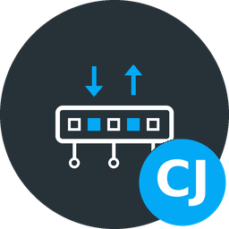

[![GitHub Release][releases-shield]][releases]
[![GitHub Activity][commits-shield]][commits]
[![License][license-shield]](LICENSE)
![Project Maintenance][maintenance-shield]

[](https://www.paypal.me/cyberjunkynl/)
[](https://github.com/sponsors/cyberjunky)

# NETGEAR Switch



Your NETGEAR Plus (smart managed) switches in Home Assistant: every port with its link, speed and
traffic, Power over Ethernet per port, the front panel LEDs and a restart button.

> **Unofficial.** An independent project, not affiliated with, endorsed by or sponsored by NETGEAR.

These switches have no API. The integration logs in to the switch's web interface and reads its
pages, with the [py-netgear-plus](https://github.com/foxey/py-netgear-plus) library, the same one
the [NETGEAR Plus](https://github.com/ckarrie/ha-netgear-plus) integration uses.

## What you get

**The switch** as a device, with its model, serial number, firmware and bootloader version, and a
link to its web interface.

**Per port**

| Entity | | Default |
|---|---|---|
| Port *n* | On when the link is up. Attributes: `switch_host`, `port`, `speed_mbps`, and where the switch reports them `name`, `enabled` and `flow_control` | on |
| Port *n* in, out | What goes into and out of the port now, in Mbit/s | on |
| Port *n* link speed | 10, 100, 1000, 2500, 5000 or 10000 Mbit/s; 0 without a link | on |
| Port *n* total in, out | What went through since the switch started, in GB | off |
| Port *n* enabled | Turns the port off and on. Only on the GS105Ev2 and GS105PE | off |

*Port n enabled* is off by default on purpose: turn off the port that leads to Home Assistant and
you can only turn it on again in the switch's own web interface, from another port.

**Per PoE port** (GS305EP/EPP, GS308EP/EPP, GS316EP/EPP)

| Entity | | Default |
|---|---|---|
| Port *n* PoE | Power over Ethernet on or off | on |
| Port *n* PoE power cycle | Takes the power off and puts it back, to restart the device on the port | on |
| Port *n* PoE power | What the port delivers, in W | on |
| Port *n* PoE status, PoE delivering | Such as `delivering_power` or `searching`; and on while it powers a device | on |
| Port *n* PoE voltage, current, temperature, class, fault | | off |

The GS316EP and GS316EPP report only the PoE power.

**The whole switch**: *In* and *Out* (the traffic over all ports together), *CRC errors* (since the
previous read, off by default), *Front panel LEDs* (GS30xEP/EPP and GS316EP/EPP) and *Restart*
(GS105Ev2, GS108Ev3, GS308Ev4 and the PoE models).

**In the Network app.** `switch_host`, `port` and `speed_mbps` on a port's link entity are there for
apps that draw your network, such as the
[Network app](https://github.com/cyberjunky/home-assistant-apps/tree/main/app-network).

### What it can't tell

- **Which device is on which port.** A NETGEAR Plus switch doesn't show its MAC address table, so no
  integration can read it. A switch that does (a MikroTik with
  [MikroTik Network](https://github.com/cyberjunky/home-assistant-mikrotik), UniFi) further up sees
  those devices behind the port the NETGEAR is on.
- **Small traffic.** The library rounds traffic to 0.01 MB/s, so less than about 80 kbit/s shows as 0.
- **Errors per port.** Only the switch's total.

## Supported models

The models py-netgear-plus 0.7.0 knows; the model is found by itself when you add the switch.

| | Models |
|---|---|
| 5 ports | GS105E, GS105Ev2, GS105PE, GS305E, GS305EP, GS305EPP, MS305E |
| 8 ports | GS108E, GS108Ev3, GS108Ev4, GS108PEv3, GS308E, GS308Ev4, GS308EP, GS308EPP, GSS108E, MS308E |
| 10 to 24 ports | GS110EMX, XS512EM, GS116Ev2, GS316EP, GS316EPP, JGS516PE, JGS524Ev2 |

Tested on a real switch: none yet. The tests run against what the library reads from saved pages of
a GS105Ev2 and a GS308EPP. Please [report](https://github.com/cyberjunky/home-assistant-netgear/issues)
what your model shows, with its diagnostics. A model that isn't in the list has to be added to the
library first.

## Installation

Through HACS: add `https://github.com/cyberjunky/home-assistant-netgear` as a custom repository of
the type *Integration*, install **NETGEAR Switch**, and restart Home Assistant.

## Setup

1. Give the switch a fixed address, in your router or on the switch itself.
2. **Settings → Devices & services → Add integration → NETGEAR Switch**, with the address and the
   password of the switch's web interface.

Home Assistant knows the switch by its serial number. When it gets another address or password:
**⋮ → Reconfigure** on the integration.

### When it can't connect

| It says | Look at |
|---|---|
| No supported switch answers | The address, whether Home Assistant can reach the switch's web interface (another VLAN?), and whether the model is in the list |
| The switch refuses the login | The password. These switches also allow only a few logins at a time: log out of the web interface in your browser, or restart the switch |

The switch is read every 30 seconds.

## Compared with NETGEAR Plus

It reads the switch with the same library, so it supports the same models and can run next to
[NETGEAR Plus](https://github.com/ckarrie/ha-netgear-plus) (the names differ: `netgear_plus` and
`netgear_switch`), though both then log in to the same switch.

Kept: the port link, link speed, traffic and totals per port, PoE on/off, power cycle and power,
the front panel LEDs, restart, and finding the model by itself.

New: the switch known by its serial number, so it keeps its entities when its address changes;
*Reconfigure* for a new address and logging in again when the password changes; the PoE status,
voltage, current, temperature, class and fault; entity names and texts in English and Dutch;
traffic in Mbit/s; firmware, bootloader and serial number on the device instead of as sensors;
diagnostics; an error in Home Assistant when the switch refuses a command; *Port n enabled* only on
models that can do it.

Left out: the *IO* sensors (in plus out), *traffic since the previous read* per port, the *response
time* sensor (it held the time between two reads), and discovery over SSDP (it matched NETGEAR
routers, not these switches).

## Diagnostics

**Settings → Devices & services → NETGEAR Switch → ⋮ → Download diagnostics** gives the model, what
it can do, and everything the integration read from the switch. The password and the serial number
are left out, so it can be shared in an issue.

## Development

```bash
uv venv --python 3.14
uv pip install -r requirements_test.txt
uv run pytest
uvx ruff check custom_components tests
```

The tests run against a fake of the library with two switches (a GS105Ev2 and a GS308EPP), so no
switch is needed.

## 💖 Support This Project

If you find this integration useful, please consider supporting its continued development:

[](https://www.paypal.me/cyberjunkynl/)
[](https://github.com/sponsors/cyberjunky)

## License

MIT, see [LICENSE](LICENSE). It reads the switch with
[py-netgear-plus](https://github.com/foxey/py-netgear-plus) (Apache 2.0). NETGEAR is a trademark of
NETGEAR, Inc.

---

[releases-shield]: https://img.shields.io/github/release/cyberjunky/home-assistant-netgear.svg?style=for-the-badge
[releases]: https://github.com/cyberjunky/home-assistant-netgear/releases
[commits-shield]: https://img.shields.io/github/commit-activity/y/cyberjunky/home-assistant-netgear.svg?style=for-the-badge
[commits]: https://github.com/cyberjunky/home-assistant-netgear/commits/main
[license-shield]: https://img.shields.io/github/license/cyberjunky/home-assistant-netgear.svg?style=for-the-badge
[maintenance-shield]: https://img.shields.io/badge/maintainer-cyberjunky-blue.svg?style=for-the-badge
